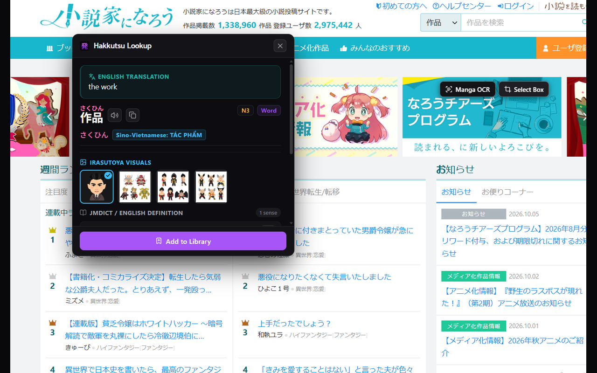
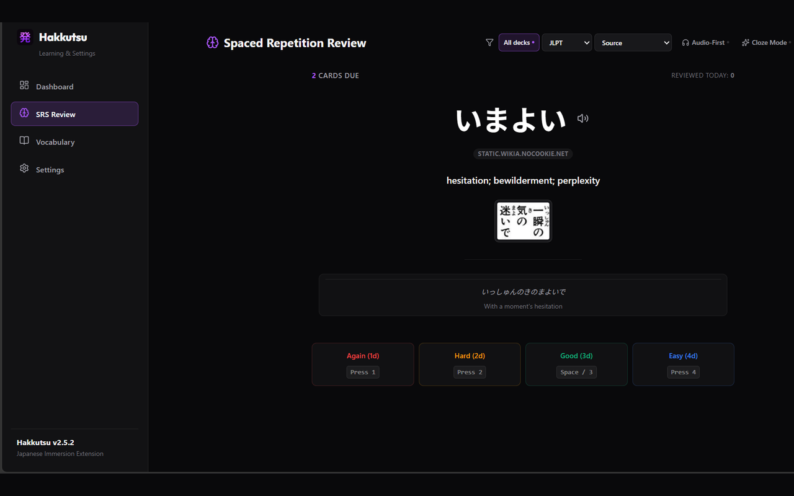

<div align="center">
  
  <h1>Hakkutsu <span lang="ja">発掘</span></h1>
  <p>Local-first Japanese immersion extension. Read, watch, mine, and review without leaving the page.</p>

  [Website](https://joshiminh.github.io/Hakkutsu/) · [Privacy](privacy.html) · [Ko-fi](https://ko-fi.com/joshiminh)
</div>

---



Hakkutsu is a browser extension for Japanese immersion. It brings inline dictionary lookup, interactive video subtitles, manga OCR, sentence mining, AnkiConnect export, and built-in spaced repetition into one local-first workflow.

**Inline lookup** — select or hover over Japanese text to see readings, definitions, JLPT level, pitch accent, kanji stroke order, and audio.

**Video subtitles** — dual-subtitle overlays for YouTube, Netflix, and compatible HTML5 players. Hover any word to inspect it; a side-panel transcript lets you follow and search by line.

**Manga OCR** — click speech bubbles to trigger on-device Tesseract LSTM recognition and look up text without typing.

**Sentence mining** — save word, sentence, source, screenshot, and tags as a vocabulary card in one click.

**Spaced repetition** — FSRS-4.5/5 scheduling with Audio-First and Cloze Deletion review modes. Smart deck filters by JLPT level, source, due status, and leech flags.

**AnkiConnect** — export with configurable mappings, or use the Japanese preset for manual two-way vocabulary sync with field-level conflict previews. Review linked text and audio cards with Anki controlling their independent schedules.

**Portable data** — CSV export or full JSON backup/restore with SRS state preserved.

**8-language UI** — English, Vietnamese, Japanese, Chinese, Korean, Spanish, French, Indonesian.

For Japanese Anki integration, select your existing deck and note type in **Settings → AnkiConnect**, choose **Japanese · 13 fields**, then open **Vocabulary → Sync with Anki**. Review and apply the preview. **Review → Anki review** requires Anki to remain open; unlinked words retain local review. Deletes stay local and AnkiWeb sync is never started automatically. See [Anki integration validation](tests/ANKI-INTEGRATION.md).

Use **Stop** to cancel a preview or finish the current sync note safely, then refresh the preview to continue. Sentence highlighting is saved locally and offered in the next manual sync preview. Word and sentence speaker buttons play existing recordings, using cached media when available.

---



## Privacy

All data stays on-device — IndexedDB and `chrome.storage`. No account, no analytics, no remote backend. AnkiConnect and any local translation server are only contacted on user action. Use **Vocabulary → Backup** before uninstalling or clearing browser data.

## Browser support

| Target | Build |
| --- | --- |
| Chromium | Manifest V3 |
| Firefox | Manifest V2 |

## Development

Requires Node.js 18+ and pnpm 8+.

```bash
pnpm install
pnpm dev
```

| Command | Purpose |
| --- | --- |
| `pnpm dev` | Dev server with HMR |
| `pnpm typecheck` | TypeScript validation |
| `pnpm test` | Subtitle, density, furigana and dictionary regression tests |
| `pnpm test:browser` | Local browser regression harness at `/tests/furigana.html` |
| `pnpm build` | Chrome MV3 → `.output/chrome-mv3` |
| `pnpm build:firefox` | Firefox MV2 → `.output/firefox-mv2` |
| `pnpm zip` | Store-ready archive |

**Load unpacked (Chrome):** `pnpm build` → `chrome://extensions` → Developer mode → Load unpacked → `.output/chrome-mv3`.

**Load unpacked (Firefox):** `pnpm build:firefox` → `about:debugging` → Load Temporary Add-on → `.output/firefox-mv2/manifest.json`.

### Page furigana

Version **2.6.2** adds complete Hán-Việt fallbacks for lookup, vocabulary, review, and dashboard views, including repairs for partial saved values such as `便利 → LỢI`. Offline readings are derived from the Unicode Unihan database; see `src/shared/japanese/data/README.md` for provenance and regeneration instructions. The Unicode license is included with the extension under `licenses/`.

Import a local dictionary in **Settings → Offline dictionary**, then open the page difficulty badge and enable selective furigana. Automatic page annotation uses only local readings; unknown words remain unchanged. Existing website ruby is preserved. Disable furigana to restore the original text.

Subtitle furigana uses the installed dictionary plus a small bundled vocabulary, without online definition or LLM requests. Import a dictionary for broader coverage; unknown readings stay blank. Subtitle and transcript lookups preserve the selected token's reading and keep conjugated readings separate from dictionary-form readings. Dictionary hovers use dictionary lookup; explicit phrase analysis still provides AI translation and breakdown.

Video subtitles preload both complete tracks when available. YouTube prefers a native target-language track, then a full translated track; Netflix downloads the selected source and target tracks concurrently. Readings and fallback translations prepare the current line and next minute first, then the rest of the film in the background. Both languages appear together at the source cue boundary; uncached automatic translations briefly show a preparation status. Translation failures show the original line with a notice. Seeking reprioritizes preparation, and disabling subtitles stops queued background work. Prepared results stay cached for the current track and language.

The importer accepts a nonempty JSON array in this format (raw JMdict XML needs conversion first):

```json
[{"id":"100001","kanjiElements":["学校"],"readingElements":["がっこう"],"senses":[{"partOfSpeech":["noun"],"glosses":["school"]}],"jlpt":"N5"}]
```

The entire file is validated before an atomic import. Entries are added or updated by ID; existing entries with other IDs are retained.

For DOM regressions and the chapter benchmark, run `pnpm test:browser`, open `http://127.0.0.1:4173/tests/furigana.html`, and click **Run tests**. `/tests/popup.html` previews the real popup with disposable browser APIs. These fixtures do not access your extension data; verify the installed extension separately on Syosetu and a chapter page in Chrome and Firefox.

## Releases

Version **2.6.3** improves subtitle loading and playback performance, vocabulary-based immersion density, selective furigana, and Hán-Việt coverage. It also refreshes the page difficulty and offline dictionary controls. See [release notes](CHANGELOG.md), [subtitle validation](tests/SUBTITLE-PERFORMANCE.md), and [density validation](tests/DENSITY-RESULTS.md).

Creating a GitHub Release builds and attaches Chrome and Firefox ZIPs. Store publishing (Chrome Web Store, Firefox AMO) runs automatically when the relevant repository secrets are configured. Release assets are always created regardless.

## Contributing

Run `pnpm typecheck`, `pnpm build`, and `pnpm build:firefox` before submitting a pull request.

## License

[MIT](LICENSE) © Hakkutsu contributors.
